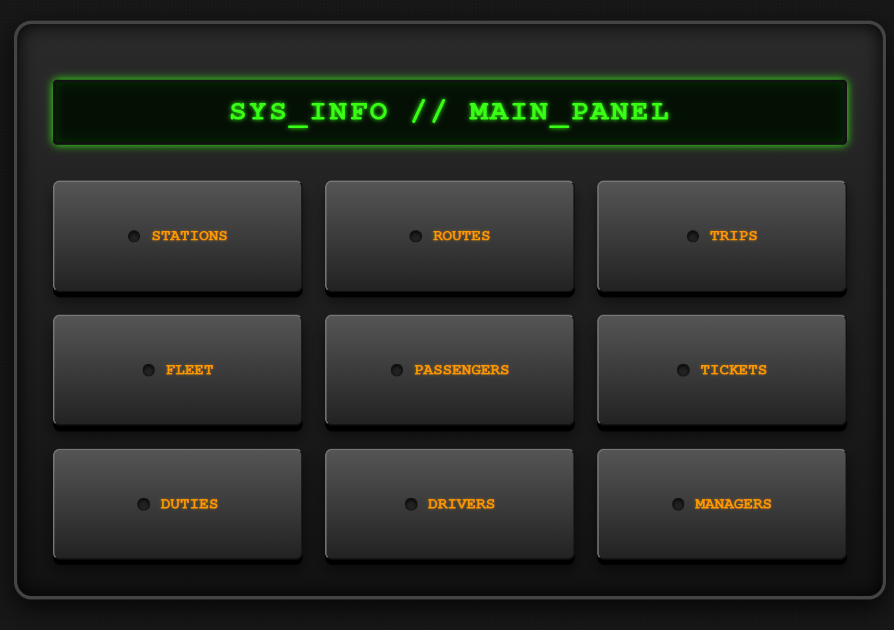
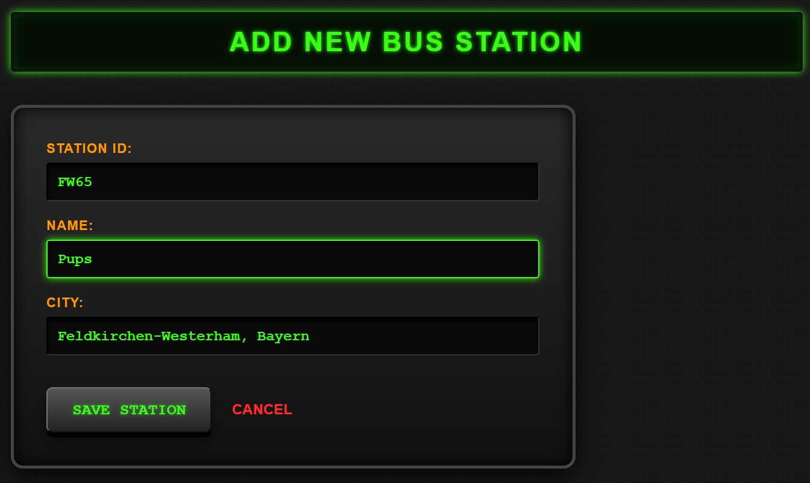
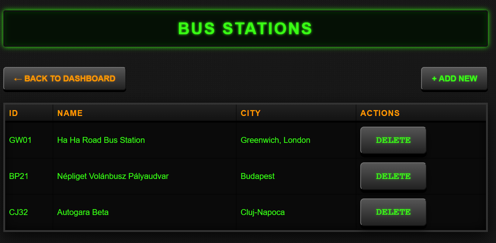
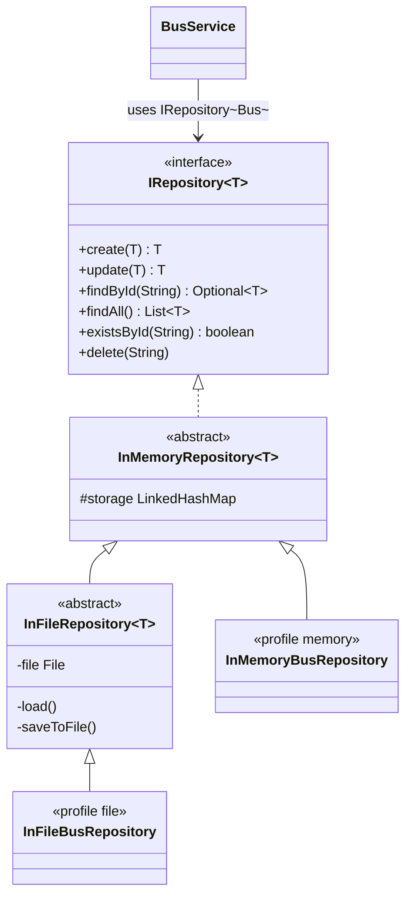

# Bus Management System

This project is a simple Bus Management System written in Java using Spring Boot.

The app uses a simple Layered Architecture following the Controller-Service-Repository Pattern, featuring a fully functional MVC web interface built with Thymeleaf.

## System Architecture and Implementation

The application is built with a focus on generic programming and code reusability to establish a robust foundation for future business logic.

### Backend Infrastructure

- **The `Identifiable` Interface:** When building our models, we decided to create an `Identifiable` interface. This ensures all entities are accessed consistently by their ID and allows us to use Java Generics across the application.
- **Generic Base Classes:** Each Service and Controller inherits from a generic base class (`BaseService`, `BaseController`). This encapsulates common CRUD operations and drastically reduces boilerplate code.
- **Single Responsibility Principle:** We explicitly maintain one Service and one Controller for each data type. This guarantees that each controller is concerned with traffic from exactly one domain. Each Service interacts only with the generic `IRepository<T>` interface for its model (e.g. `IRepository<Bus>`) to respect the dependency inversion principle.
- **Repository Structure:** We have a generic `IRepository<T>` interface that the services interact with directly. For each type of repository (`InMemoryRepository` and `InFileRepository`) we built an abstract class that is inherited by each datatype repository (ex: `InMemoryBusRepository` extends `InMemoryRepository<Bus>`, `InFileBusRepository` extends `InFileRepository<Bus>`). See *Project 3 Changes* below for details.

For ease of development and collaboration, we decided to build one Service and one Controller for each data type. 
This adheres to the Single Responsibility Principle and ensure that each controller is concerned with traffic from exactly one domain.

### Frontend & MVC Routing
* **Thymeleaf Integration:** The `@Controller` layer dynamically renders HTML templates. We developed a generic form-binding system where the `BaseController` automatically passes empty entity templates (e.g., `new Bus()`) to frontend views to ensure seamless object binding (`th:object`) and data submission.
* **UI Design:** The system features a custom 2000s-style instrument panel UI, utilizing modular Thymeleaf fragments to dynamically generate navigation and action bars across all entity views.

  
  
  

## Assignment Context

### Model Expansions
We expanded three core UML models with additional attributes:
* **Staff:** Added `salary` to manage payroll.
* **Driver:** Added `decorations` to track cabin flair and keep each driver's personality in mind
* **Bus:** Added a boolean `hasAC` and a custom Enum `FuelType` to better define the vehicle's hardware specifications.
  **Design Justification:** We deliberately kept `decorations` as an attribute of the `Driver` rather than the `Bus`. In our domain model, items like family photos or dashboard figures are personal belongings that a driver brings to their shift. When the driver's shift ends and they change vehicles, their decorations leave with them. Therefore, this represents a property of the employee's personal workspace, not the hardware of the vehicle itself.

### Data Type & Visibility Fixes
* **Enum Refactoring:** Properties that were previously generic `Strings` (like `BusStatus` and `FuelType`) were refactored into explicit `Enums`. Furthermore, `FuelType` was made strictly `public` to guarantee proper visibility for Thymeleaf getters/setters.
* **Data Type Corrections:** Updated `yearsOfExperience` in the `Driver` model from a `String` to an `int`.

## Roadmap: Future Business Logic

While our current focus was establishing a robust MVC baseline with generic operations, the following items are our top priorities for the upcoming phases of development:

* **Advanced Domain Logic:** We will transition away from pure generic CRUD operations (`BaseService.create()` / `update()`) to implement dedicated domain logic and chain reactions (e.g., `scheduleTrip()`, `bookTicket()`, and `assignStaffToTrip()`).
* **Double Booking & Validation:** We will implement strict validation to prevent double-booking. Future updates will verify the existence of referenced IDs and validate specific combinations (e.g., checking if a specific seat on a specific trip is truly available before saving a ticket).

## Project 3 Changes: JSON Storage and Full CRUD

This section describes what changed for Project 3.

### Running the Application
The storage mode is selected with a **Spring profile** when the application starts:

| Profile | Behaviour |
|---|---|
| `file` (default) | Data is loaded from the JSON files in `src/main/resources/data/`, and every change made in the UI is written back to them, so it survives a restart. |
| `memory` | Data lives only in memory. Every start loads the same initial data from the JSON files; changes are lost on restart and the files are never modified. |

The default is set in `application.properties` (`spring.profiles.active=file`). To start in the other mode:
- **Maven:** `./mvnw spring-boot:run "-Dspring-boot.run.profiles=memory"`

Settings used only by the file mode are in `application-file.properties`: `app.data-dir` (the folder with the JSON files, relative to the project root) and `spring.devtools.restart.additional-exclude=data/**` (stops DevTools from restarting the app whenever a JSON file is saved).

### Repository Layer

* **One generic interface:** `IRepository<T>` defines all CRUD operations. `save` was split into `create` and `update`, and `findById` returns an `Optional`. The per-entity interfaces (`BusRepository`, …) were removed, because they had no methods of their own: services now receive `IRepository<Bus>` directly, and Spring injects the right implementation by its generic type.
* **`InMemoryRepository<T>`:** Implements all CRUD operations once for every entity. Data is kept in a `LinkedHashMap` (stable order), `create` generates a UUID when the ID is blank and rejects duplicate IDs, `update` rejects unknown IDs, and all methods are `synchronized` because one repository object is shared by all web requests.
* **`InFileRepository<T>` extends `InMemoryRepository<T>`:** A file repository is the in-memory repository plus persistence. It reads its JSON file once at startup (checking that every ID is present and unique) and rewrites the file after every `create`, `update` and `delete`. Because the CRUD and ID logic is inherited, both storage modes behave identically.
* **One class per entity and mode:** e.g. `InFileBusRepository` only passes its file name (`bus.json`) and model class to `InFileRepository`, and `InMemoryBusRepository` is empty. The `@Profile` annotation on each class decides which set of repositories exists at runtime.
* **Naming:** the assignment calls the interface `AbstractRepository<T>`; our `IRepository<T>` plays that role, and our `InFile…Repository` classes are the per-entity classes that inherit from `InFileRepository<T>`.

### Data Files and Initial Data
* **JSON files:** `src/main/resources/data/` contains one file per entity (`bus.json`, `bus-station.json`, `route.json`, `bus-trip.json`, `driver.json`, `trip-manager.json`, `passenger.json`, `ticket.json`, `duty-assignment.json`). Each file is a JSON array with at least 10 valid records whose references all point to existing records.
* **IDs:** `Identifiable` now has `setId(String)` and all IDs are Strings. IDs are random UUIDs; they are never typed in or shown in the UI.
* **Relationships are stored once:** A relationship is saved only as the ID on the "many" side (e.g. `Ticket.tripId`). The list attributes from the UML (`BusTrip.tickets`, `Driver.assignments`, …) stay in the models but are marked `@JsonIgnore`, so the same relationship is never stored twice. The lists can always be rebuilt from the saved IDs, so nothing is lost on restart.
* **Memory mode:** `config/MemoryDataSeeder` is a `CommandLineRunner` active only in the `memory` profile. On every start it reads the JSON files from the classpath and stores each record through `IRepository.create(...)`, in dependency order. It never writes anything back.

### Services and Controllers
* **Labels:** Each service defines how its entities are shown to the user (`label(...)`), e.g. a bus by its registration number. `RouteService` builds "Origin → Destination" from the station names, and `BusTripService` adds the start time to the route name. `labels()` returns an *ID → name* map that the pages use to show names instead of IDs.
* **Routes:** `BaseController` now provides all CRUD routes for every entity:

| Route | Purpose |
|---|---|
| `GET /bus` | List |
| `GET /bus/new` | Form for a new object |
| `POST /bus` | Create |
| `GET /bus/{id}` | Details |
| `GET /bus/{id}/edit` | Form for editing |
| `POST /bus/{id}` | Update |
| `POST /bus/{id}/delete` | Delete |

* **Reference data:** Controllers whose entities reference others (`RouteController`, `BusTripController`, `TicketController`, `DutyAssignmentController`) override the `addReferenceData` hook to add the label maps of the referenced entities.

## Authors

- [Dan Bărăian](https://www.github.com/CodingGoose)
- [Andrei Foltiș](https://www.github.com/andrei-foltis)

