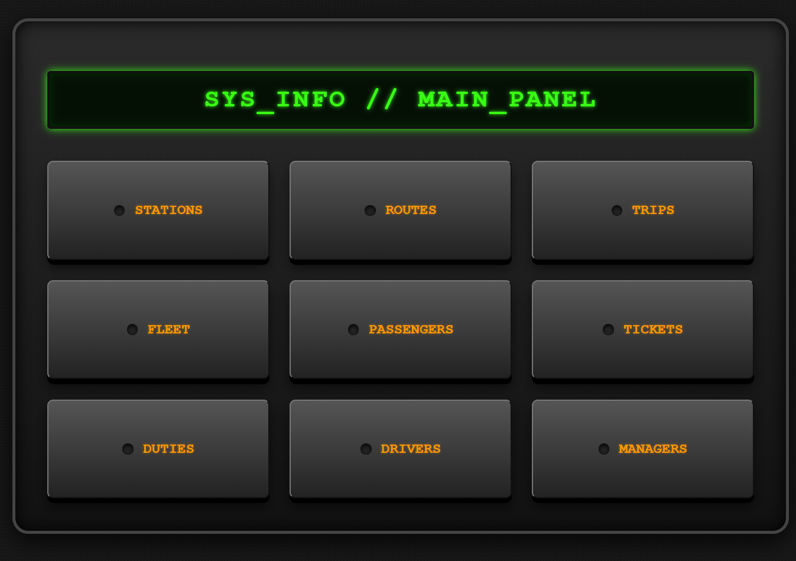
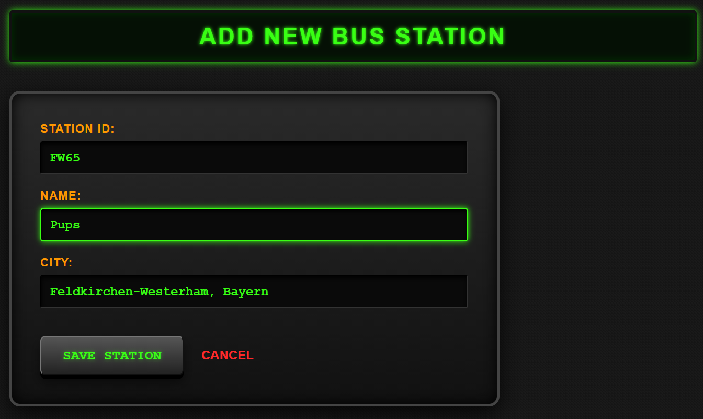
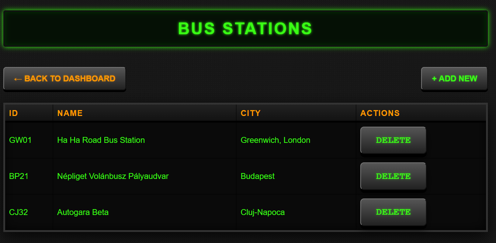

# Bus Management System

This project is a simple Bus Management System written in Java using Spring Boot.

The app uses a simple Layered Architecture following the Controller-Service-Repository Pattern, , featuring a fully functional MVC web interface built with Thymeleaf.

## System Architecture and Implementation

The application is built with a focus on generic programming and code reusability to establish a robust foundation for future business logic.

### Backend Infrastructure

- **The `Identifiable` Interface:** When building our models, we decided to create an `Identifiable` interface. This ensures all entities are accessed consistently by their ID and allows us to use Java Generics across the application.
- **Generic Base Classes:** Each Service and Controller inherits from a generic base class (`BaseService`, `BaseController`). This encapsulates common CRUD operations and drastically reduces boilerplate code.
- **Single Responsibility Principle:** We explicitly maintain one Service and one Controller for each data type. This guarantees that each controller is concerned with traffic from exactly one domain. Each Service interacts with a Repository interface made for each different model to respect the dependency inversion principle.
- **Repository Structure:** We have a generic `IRepository` interface that is then extended by the repository interfaces of each model, these repository interfaces are the ones the services interact with. For each different type of repository (i.e. `InMemoryRepository` or `InFileRepository` in the future) we built an abstract class to then be inherited by each datatype repository (ex: `InMemoryBusRepository` extends `InMemoryRepository` and implements `BusRepository`)

For ease of development and collaboration, we decided to build one Service and one Controller for each data type. 
This adheres to the Single Responsibility Principle and ensure that each controller is concerned with traffic from exactly one domain.

### Frontend & MVC Routing
* **Thymeleaf Integration:** The `@Controller` layer dynamically renders HTML templates. We developed a generic form-binding system where the `BaseController` automatically passes empty entity templates (e.g., `new Bus()`) to frontend views to ensure seamless object binding (`th:object`) and data submission.
* **UI Design:** The system features a custom 2000s-style instrument panel UI, utilizing modular Thymeleaf fragments to dynamically generate navigation and action bars across all entity views.

  
  
  

## Assignment Context

### Model Expansions
We expanded three core UML models with additional attributes:
* **Staff:** Added `salary` to manage payroll.
* **Driver:** Added `decorations` to track cabin flair and keep each driver's personality in mind
* **Bus:** Added a boolean `hasAC` and a custom Enum `FuelType` to better define the vehicle's hardware specifications.
  **Design Justification:** We deliberately kept `decorations` as an attribute of the `Driver` rather than the `Bus`. In our domain model, items like family photos or dashboard figures are personal belongings that a driver brings to their shift. When the driver's shift ends and they change vehicles, their decorations leave with them. Therefore, this represents a property of the employee's personal workspace, not the hardware of the vehicle itself.

### Data Type & Visibility Fixes
* **Enum Refactoring:** Properties that were previously generic `Strings` (like `BusStatus` and `FuelType`) were refactored into explicit `Enums`. Furthermore, `FuelType` was made strictly `public` to guarantee proper visibility for Thymeleaf getters/setters.
* **Data Type Corrections:** Updated `yearsOfExperience` in the `Driver` model from a `String` to an `int`.

## Roadmap: Future Business Logic

While our current focus was establishing a robust MVC baseline with generic operations, the following items are our top priorities for the upcoming phases of development:

* **Advanced Domain Logic:** We will transition away from pure generic CRUD operations (`BaseService.save()`) to implement dedicated domain logic and chain reactions (e.g., `scheduleTrip()`, `bookTicket()`, and `assignStaffToTrip()`).
* **Double Booking & Validation:** We will implement strict validation to prevent double-booking. Future updates will verify the existence of referenced IDs and validate specific combinations (e.g., checking if a specific seat on a specific trip is truly available before saving a ticket).

## Authors

- [Dan Bărăian](https://www.github.com/CodingGoose)
- [Andrei Foltiș](https://www.github.com/andrei-foltis)

